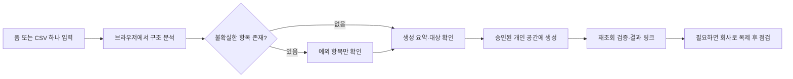

# [NB-V2-007 작업 보고서]

조사일: 2026-10-30 KST. 상태: **조사·설계 완료, 구현하지 않음**.

권고: **폼 또는 CSV 하나로 시작 → 불확실한 항목만 확인 → 최소 DB 생성 → 필요한 기능만 추가**하는 제품으로 전환한다. 개인 Notion 생성 후 회사 복제는 우선 검증할 후보이며, 관계형 보존을 확인하기 전에는 운영 권장 방식으로 확정하지 않는다.

## 1. 실제 최신 Git·배포 상태

| 구분 | 이번 조사에서 확인한 상태 |
| --- | --- |
| 로컬 Git | `main / 06a7c526e8cf93dcfed5c33072c1d23349a134df`, 커밋명 `추가 구현 7` |
| 커밋 시각 | 2026-10-29 17:36:40 +09:00 |
| 시작 작업 트리 | `main...origin/main`, 변경 파일 없음. 원격 Git fetch/push는 하지 않음 |
| 운영 주소 | https://pplus-rouge.vercel.app |
| Vercel | `dpl_CRxCKAc6GQGLV8LKjLHmJToNbhSs`, READY, Git/main/`06a7c52` |
| 배포 원본 주소 | https://pplus-9py8nppde-pplus1.vercel.app |
| Supabase 읽기 전용 조회 | `public.education_drafts` 존재, RLS 및 FORCE RLS 활성, 정책 3개 |
| 이번 원격 변경 | DB·Auth 설정·Notion·Vercel 변경 없음 |
| 이번 로컬 변경 | 이 보고서, ChatGPT 인계 문서, 조사 근거 JSON만 추가 |

NB-V2-006 당시의 ‘프런트 미배포’ 기록은 당시 상태다. **현재 운영에는 NB-V2-006 저장 UI가 반영돼 있다.** 이번에 재배포한 것은 아니다. Supabase Site URL/Redirect URLs는 이번 조사에서 재조회하지 않았으며 이전 적용 보고를 현재 재검증 결과로 대체하지 않는다.

## 2. 현재 화면 및 기능 구성

| 화면/계층 | 실제 기능 | 새 방향과의 간격 |
| --- | --- | --- |
| `login.html`, `js/auth*.js` | Supabase 이메일 인증, 로그인·로그아웃, 세션 확인 및 보호 화면 | 재개발할 필요 없음 |
| `index.html`, `js/app.js`, `js/mock-data.js` | 교육명·목적·8개 모듈 선택, sessionStorage, 규칙 기반 Mock 결과 | 폼/CSV가 주 입력이 아니며 해커톤 모델 없음 |
| `result.html` | DB·관계·수식 설명, 복사, 요구사항 수정, 재생성 | 실제 Notion 생성 결과가 아닌 구축 안내 |
| `mapping.html`, `js/mapping-ui.mjs` | 폼 질문 + 선택적 CSV 파일 분석, 속성·옵션·색상·Status 편집, JSON 다운로드 | CSV 텍스트 입력과 실제 생성 버튼 없음 |
| `js/drafts/*.mjs` | 내 설계 목록, 새 설계, 저장/복사본 저장, 열기, 입력·매핑 복원 | Notion 생성 이력/토큰 저장 기능은 없음 |
| `scripts/notion-poc/*.mjs` | 별도 Node CLI, 지정 개인 테스트 페이지 아래 생성·관계·계산·재조회 | 고정 테스트 스키마/가상 행에 결합. 웹 매핑을 받는 범용 엔진 아님 |
| 공개 빌드 | `scripts/deployment/build-static.mjs`, `vercel.json`, 정적 공개 파일 제한 | 웹 서버 생성 API/작업 큐는 아직 없음 |

현재 제품에는 **V1 Mock 모델, 매핑 모델, 실제 CLI 스키마**라는 서로 다른 모델이 있다. 저장 기능이 세 모델을 하나의 생성 모델로 통합한 것은 아니다. AI API 호출은 없으며 자유 요구사항은 의미 분석하지 않는다.

## 3. UI·UX 문제 목록과 심각도

P1: 핵심 편집 방해/잘못된 결과 위험. P2: 작업량·인지 부담. P3: 정돈·유지보수. 이번 범위에서 확인한 P0 장애는 없다.

| ID | 문제·발생 위치 | 근거/심각도 | 수정 방향 |
| --- | --- | --- | --- |
| UI-01 | 1280px 매핑 화면을 아래로 스크롤하면 제목·안내 박스가 속성 행 위에 겹침 | **운영 브라우저 재현**, P1 | 입력 화면용 sticky를 `.input-page .intro`처럼 제한하거나 매핑 intro를 static 처리. z-index만 올리는 방식은 가림을 악화시킴 |
| UX-02 | 모든 보호 화면 위에 저장 패널, 4개 버튼, 긴 설명이 반복됨 | 실제 390/768/1280 화면, P2 | 현재 설계명·저장 한 줄을 기본으로 하고 목록/복사본/새 설계는 접기 또는 보조 메뉴 |
| UX-03 | 모바일 메인 입력칸이 헤더·저장 패널·소개·안내 아래로 밀림 | 실제 390px 화면, P2 | 입력을 먼저 배치하고 안내를 축약. 높이를 고정해 잘라내지 않음 |
| UX-04 | 모든 속성·색상·대상 DB를 처음부터 편집해야 할 것처럼 보임 | 실제 매핑 화면 및 렌더 코드, P2 | 자동 확정 요약 + ‘확인 필요 N개’만 펼침. 고급 편집은 선택 |
| UX-05 | `AI 설계 생성`, `AI 노션 빌더`, 대시보드 중심 문구와 실제 Mock/Dry Run 기능의 차이 | 실제 운영 문구, P1(기대 불일치) | 다음 구현에서 현재 동작에 맞는 ‘설계 미리보기’ 등으로 정리. 실제 생성 전에는 생성 완료라고 표시하지 않음 |
| UX-06 | 메인→결과와 메인→매핑이 별도 분기이며 매핑→실제 생성 연결 없음 | 코드+운영 이동, P1(목표 미충족) | 하나의 설정 모델과 입력→검토→생성 결과 동선 |
| UX-07 | CSV 단독은 파일만 가능하고 ‘폼과 비교’ 문구가 두 입력을 요구하는 듯 보임 | `mapping.html:25`, `:28`, P2 | ‘폼 붙여넣기 또는 CSV’ 및 CSV 텍스트 입력. 두 번째 자료는 선택적 보완 |
| UI-08 | 긴 CSV 컬럼을 native select에서 구분하기 어려울 가능성 | 정적 분석, P2, **긴 CSV 실제 화면 미검증** | 선택한 컬럼의 번호·전체 원문을 별도 줄에 표시. 중복은 위치로 구분 |
| UI-09 | 모바일 Status는 한 옵션의 이름/색상과 그룹/제외가 두 줄로 배치됨 | 실제 390px, 겹침은 확인되지 않음. P2(복잡성) | 옵션별 카드/명시적 레이블, 고급 그룹 편집 접기 |
| UI-10 | 헤더/저장 패널 600px, 본문 680px, 매핑 700px, 레이아웃 960px 경계가 다름 | CSS 정적, P3; 경계 폭 전체 재현 안 함 | 공통 간격·반응형 기준 정리, 600/680/700/960 전후 재검사 |
| UI-11 | 매핑 헤더는 텍스트 뒤로가기, 메인/결과/로그인은 로고 사용 | 실제 화면+HTML, P3 | 공통 헤더와 뒤로가기 위치 통일 |

관찰한 기본 화면에서 전체 페이지 가로 스크롤을 명확히 재현하지는 못했다. 이를 ‘모든 내용에서 가로 넘침 없음’으로 확대 해석하지 않는다. 결과 표/수식의 내부 가로 스크롤은 전체 페이지 넘침과 구분한다. 초기 확대 배율에서 보인 잘림은 페이지 배율 100%로 바로잡은 뒤 결함 판정에서 제외했다.

## 4. 문제 재현 방법과 관련 코드 위치

**UI-01 재현:** 운영 사이트 로그인 → `mapping.html` → CSS 뷰포트 1280px → ‘2. 속성과 색상 검토’까지 스크롤 → 진행 상태 행까지 내려간다. 위의 ‘질문과 컬럼을…’ 제목 및 안내 박스가 편집 행을 덮는다. 1280×750, 미리보기 표시 50%, 페이지 배율 100%에서 두 번 관찰했다. 표시 배율은 CSS 뷰포트 폭과 별개다.

근거: `mapping.html:25`의 `class="intro"`가 `css/style.css:138`의 `position:sticky; top:50px`를 상속한다. `css/style.css:974` 이하에서는 960px 이하일 때 static으로 바꾼다. 매핑 CSS에는 별도 해제가 없다. 같은 sticky는 2열 입력 화면을 위한 것으로 보이나 매핑 화면은 수직 문서이므로 겹친다는 원인 설명은 소스에 근거한 판단이다. 이번에는 수정하지 않았다.

추가 조사 위치:

- 저장 패널/목록: `js/drafts/ui.mjs:26`, `:42`, `:80`; `css/drafts.css:1`, `:6`, `:10`, `:14`. 상태 문구 빈 공간과 설명·상하 여백이 패널 높이를 늘린다. 목록은 25개씩 명시적으로 조회한다.
- 헤더 계정: `css/auth.css:21`, `:25`. 이메일은 말줄임·줄바꿈 보호가 있다. 계정 정보 자체의 겹침은 관찰한 기본 화면에서 재현하지 못함.
- 결과 반응형: `css/style.css:555`, `:588`, `:623`, `:712`, `:835`, `:974`, `:1000`. 표/코드는 overflow 처리가 있음. 긴 제목·모든 펼침 조합은 추가 검증 대상.
- 매핑 필드·옵션: `js/mapping-ui.mjs:31` 이후 `render`, `css/mapping.css:1`. 2열 속성, 3/4열 옵션, 700px 이하 2열 옵션으로 전환한다.
- 로그인: `css/auth.css:5`, `:11`, `:25`. 390/768/1280에서 기본 로그인 카드·비밀번호 표시 버튼이 겹치지 않는 것을 관찰함. 제출/오류/회원가입 모든 상태를 이번에 재실행하지 않음.

**실제 화면 관찰 범위:**

| 화면 | 390px | 768px | 1280px |
| --- | --- | --- | --- |
| 로그인 | 390×844 기본 카드 | 768×844 기본 카드 | 1280×844 기본 카드 |
| 입력 | 390×375 상단/본문/생성 버튼 | 768×750 상단/소개 | 1280×750 상단/2열 시작 |
| 결과 | 390×375 저장 패널 및 결과 AX | 768×750 결과 제목/버튼 | 1280×750 결과 제목/버튼 |
| 매핑 | 390×750 일반 옵션/Status 두 줄 | 768×750 일반 옵션 편집 | 1280×750 Status와 **sticky 겹침** |

결과의 모든 표·수식과 입력 폼 전체를 각 폭에서 모두 순회한 전수 검사는 아니다. 저장 목록은 실제 조회 성공과 ‘열기’ 요소를 AX로 확인했지만, 펼친 목록 전체의 픽셀 배치·긴 제목·25개 이상 목록은 미검증이다. 긴 CSV 가상 파일의 OS 선택 창 입력이 안정적으로 완료되지 않아 선택을 취소했다. 파일 업로드/분석 성공으로 기록하지 않는다. 화면 캡처는 도구로 관찰했으며 별도 PNG 파일은 남기지 않았다.

## 5. 네이버 폼 단독 입력 평가

`js/mapping/parse.mjs:18`은 번호 있는 질문을 나누고 등록된 별칭·단일/복수 선택 문구·선택지로 추천한다. 실제 네이버 폼 전체 복사의 모든 표시 형식을 지원하는 파서는 아니다.

| 항목 | 평가 |
| --- | --- |
| 입력 횟수 | 붙여넣기 1회. 기존 화면에서 분석 1회, 미리보기 1회, 필요하면 다운로드 1회 |
| 자동 가능 | 번호, 질문명, 일부 필수 표시, 명시적 단일/복수 선택과 옵션, 등록된 이메일/전화 등 |
| 확인 필요 | 번호 누락, 서술형과 별칭 충돌, 설명문/선택지 구분, 대상 DB, 임의 질문의 의미 |
| 정확도 | 지원 형식의 예제는 양호. 실제 폼 코퍼스 정확도 %는 산출하지 않음 |
| 중복 | 질문 번호/속성명/선택지 충돌 표시. 같은 뜻인지 추측해 합치지 않음 |
| 개인정보 | 질문 구조만 붙여넣기. 자유 입력에 응답이 섞이면 자동 익명화된다는 보장 없음 |

이번 실행: `docs/mapping/EXAMPLE_FORM.txt` 5문항 → 기본 3속성 포함 총 8속성, 확인 필요 0, 검증 오류 0. 안내문 경고는 남는다.

**정확도 문제 재현:**

1. `성명\n단답형\n이메일\n단답형`은 질문 0개, 기본 속성 3개만 생성되는데 검증 오류 0. `parseForm` 경고와 별개로 `validateModel`이 ‘실제 입력 속성 0개’를 막지 않는다. 생성 파이프라인 진입 전에 중단해야 한다.
2. `1. 신청 동기\n장문형`은 별칭 규칙이 select여서 선택지 없는 select로 추천된다. 확인 필요/검증 오류로 막히므로 실제 생성 성공은 아니지만 불필요한 수정을 유발한다. 명시된 장문형/단답형을 별칭보다 우선해야 한다.
3. `성명(*)`처럼 정규화로 인식되는 예는 있으나 모든 필수 표시를 읽지는 못한다. 필수 표시는 Notion DB의 입력 필수 제약으로 자동 구현되는 것도 아니다.

## 6. CSV 단독 입력 평가

`js/mapping/csv.mjs`는 BOM·인용부호·따옴표 내부 줄바꿈을 처리하고 첫 레코드만 분석한다. UTF-8 또는 EUC-KR/CP949를 선택하며 헤더 한도는 64KiB다. 원본 컬럼 번호와 빈 이름/정규화 후 중복 문제를 유지한다.

| 항목 | 평가 |
| --- | --- |
| 입력 횟수 | 파일 선택 1회(파일 대화상자 별도). CSV 텍스트 UI는 미구현 |
| 자동 가능 | 컬럼명·순서·중복/빈 이름, 등록된 명칭의 제한적 추천 |
| 확인 필요 | 헤더 유무, 선택지, 단일/복수, 날짜/숫자 의미, 어느 DB의 어느 속성인지 |
| 정확도 | 컬럼 구조 파싱과 의미 추론을 구분. 헤더만으로 옵션 목록을 복원할 수 없음 |
| 오추천 위험 | ‘신청 과정’이 단일/복수인지 알 수 없으며 코드에서는 select로 추천 |
| 중복 | 컬럼 index로 보존. 같은 이름 2개를 자동 병합하면 안 됨 |
| 개인정보 | 파일은 브라우저 slice로 읽고 응답 행을 파싱·보관하지 않음. 내부 청크에 헤더 뒤 바이트가 일부 들어올 수 있으나 해독/저장 전 버림 |
| 현재 클릭 | 분석+미리보기 2회 + 행별 확인/수정. 다운로드하면 1회 추가. 실제 생성 클릭은 없음 |

이번 예제 5컬럼 → 총 8속성, CSV 속성 5개 모두 확인 필요, 옵션 누락을 포함한 검증 오류 8개. **오류 8개는 8개 컬럼을 뜻하지 않는다.** 이 경로를 ‘확인 없이 바로 생성 가능’이라고 보고하면 안 된다.

제안: 의미가 불명확한 컬럼은 안전한 텍스트로 보존한다. 선택지 목록을 사용자가 보완할 때만 Select/Multi-select로 바꾼다. CSV 텍스트도 전체 내용을 서버로 보내지 않고 첫 레코드만 추출한다. 헤더 없는 파일을 자동 감지한다고 약속하지 말고, 첫 줄이 컬럼명인지 확인하게 한다. CSV 첫 줄 자체에 개인정보가 있으면 현재 구조만으로 완전 차단하지 못한다. 설계 저장에는 헤더·질문이 포함되므로 ‘아무 개인정보도 저장 불가능’이라는 표현도 피한다.

## 7. 네이버 폼 + CSV 입력 평가

`parse.mjs:56` 이후 원문 질문명 정규화 일치 → 등록 별칭 일치 순으로 연결한다. 유일한 후보만 자동 연결하며, 중복 헤더/경쟁 질문은 확인 대상으로 남긴다. CSV에만 있는 컬럼도 보존한다.

- 입력 2회. 분석+미리보기는 각 1회이며 모호한 연결만 추가 확인한다. 현재 모든 상세 행이 노출되는 점은 개선 대상이다.
- 폼은 질문 유형·선택지, CSV는 실제 컬럼명·순서를 보완한다. 같은 버전의 자료라는 보장은 없으므로 불일치를 덮어쓰지 않는다.
- 이번 5문항+5컬럼 예제: 8속성, 확인 필요 0, 오류 0. **예제 결과이며 실제 자료 전체의 정확도 보장이 아니다.**
- 추가 입력을 강제할 이유는 없다. 기존 CSV와 정확한 연결이 필요한 사용자에게만 함께 입력을 권한다. 개인정보 원칙은 두 단독 방식과 동일하다.

## 8. 가장 간단한 생성 흐름 제안

위 흐름은 **설계 제안**이며 웹 생성 기능은 아직 없다. 첫 화면에는 프로그램명과 ‘폼 붙여넣기 / CSV 파일·텍스트’만 우선 배치한다. 교육/해커톤·최소형은 기본값을 제공하고, 기능 모듈은 선택으로 둔다. 원문 없는 임의 텍스트의 의미를 AI 없이 이해한다고 약속하지 않는다.

기본 경로 목표: 입력 1회 → ‘분석’ 1클릭 → 대상·DB 수·민감 데이터 제외를 보여주는 ‘생성’ 1클릭. 즉 로그인/연결/파일 선택/회사 복제 제외 **제품 내 2클릭 목표**다. 미리보기를 분석과 합치거나 충분히 검증된 규칙에서는 더 줄일 여지가 있지만, 원격 생성 대상 확인을 없애지 않는다. 예외가 N개면 확인 작업이 늘어난다. 재분석 시 편집을 덮어쓰기 전 차이를 보여준다.

현재는 A/B/C 모두 **실제 생성까지 필요한 클릭 수를 셀 수 없다**. 생성 경로가 없기 때문이다. 분석·검토·JSON 저장만 가능한 상태를 구분한다.

## 9. 개인 Notion 생성 후 회사 복제 방식 평가

**조건부 우선 후보.** 지정 개인 공간에 빈 DB 묶음을 만들고 사용자가 회사로 복제하면 회사 연결 없이 시작할 수 있다. 기존 CLI의 HTTP·관계/계산 순서·검증을 재사용할 여지가 크다. 다만 지금 CLI는 가상 테스트 행을 넣고 출석 값을 바꾸므로 운영용으로 그대로 호출해서는 안 된다.

공식 절차: 같은 계정의 다른 워크스페이스는 상위 페이지에서 `Move to` → 대상 → 복제 확인. 서로 다른 계정은 임시 상위 페이지를 상대 계정에 Full access로 초대하고, 받은 계정에서 **내부 페이지들을 선택해** 이동·복제한다. 공유한 바깥 컨테이너 자체는 해당 절차로 복제할 수 없으므로, 생성 묶음 페이지를 그 안에 넣는 구조를 검토한다. 링크·관계·권한·이력이 손상될 수 있고, 회사의 게스트/이동 제한이 영향을 준다. 이번에는 실행하지 않았다. [공식 이동·복제 안내](https://www.notion.com/help/transfer-content-to-another-account)

공개 템플릿 경로는 로그인한 수신자가 `Duplicate`와 목적 워크스페이스를 선택하는 방식이며 하위 페이지도 포함한다. 접근 불가 블록이 남을 수 있다. **비공개 초대와 공개 배포는 별개**다. 공개 템플릿은 빈 스키마·가상 예시만 포함하고 사내 제목/응답/링크/첨부를 점검해야 한다. 이번에 공개나 초대 설정을 바꾸지 않았다. [공식 공개 페이지 복제 안내](https://www.notion.com/help/duplicate-public-pages)

관계 있는 DB 하나만 복제하는 경우 양방향이 단방향으로 바뀐다는 공식 예가 있다. 이것은 전체 묶음 복제의 내부 참조 보존을 보장하는 설명이 아니다. [공식 관계형 FAQ](https://www.notion.com/en-gb/help/relations-and-rollups)

최소 사용자 작업은 생성 링크 열기→회사 쪽 복제 절차→검증이다. 계정 전환/초대/권한/조직 제한에 따라 늘어나므로 고정 2~3클릭을 보장하지 않는다.

후속 개인 테스트 환경에서 검증할 항목(이번 미실행):

1. 두 개인 테스트 공간과 별도 계정 경로를 나눠, DB 2개·단/양방향 관계·롤업·수식·색상으로 작은 묶음을 준비한다. 회사에는 접속하지 않는다.
2. 모든 실제 DB를 한 묶음 내부에 둔다. 외부 DB의 linked view만 넣은 상태와 구분한다.
3. 복제본 DB ID/관계 대상이 복제본인지 확인한다. 이름이 같다는 이유로 통과하지 않는다. 롤업·수식의 대상 속성, 역방향 관계, 행 연결, view 필터도 점검한다.
4. 복제본의 가상 값만 바꿨을 때 복제본 KPI만 바뀌고 원본은 그대로인지 확인한다. 원본 접근이 없는 수신 계정에서도 확인한다.
5. 빈 DB/분모 0, 샘플 값, 옵션·Status 그룹, 접근 불가 블록을 확인한다. 원본 비공개화/공유 해제 실험은 별도 승인 범위에서만 한다.
6. 원본을 유지한 채 통과/부분 성공/실패를 기록한다. 복제본 URL과 검증 여부를 원본 생성 기록과 분리한다.

복제본의 ID와 권한은 원본과 다르다. 원본 개인 토큰으로 회사 복제본의 이후 모듈 추가·색상 변경까지 할 수 있다고 가정하지 않는다. 회사 연결 없이 지원할 수 있는 것은 재생성 후 다시 복제하거나 사용자에게 변경 안내를 제공하는 수준이다.

## 10. 템플릿 복제·CSV 방식 비교

| 방식 | 장점 | 한계·적합한 시점 |
| --- | --- | --- |
| 개인 API 생성→복제 | 사용자 입력에 맞춘 구조, 기존 엔진 활용 | 복제 검증과 생성 서버 필요. 회사 복제본 수정 권한은 별도 |
| 검증된 고정 템플릿→CSV | 구조가 반복되는 경우 초기 개발·사용이 단순 | 임의 폼/모듈 자동 구성에 약함. 템플릿 버전·복제 품질 검증 필요 |
| 사용자 OAuth→목적 공간 직접 생성 | 복제 없이 대상 ID를 직접 관리하고 확장 가능 | 연결 승인·서버·토큰 수명 관리 필요. 회사 정책 제약 가능 |

CSV 새 가져오기는 관계형·롤업·수식을 만들지 못한다. 기존 DB 가져오기는 기존 관계 속성에 컬럼을 매핑할 수 있다는 최신 안내가 있으나, 어떤 키로 어느 행을 연결하는지 실제 검증해야 한다. 가져오기/병합은 기존 행 업데이트가 아니라 추가라서 재가져오기 중복에 주의한다. [공식 CSV 가져오기](https://www.notion.com/help/import-data-into-notion)

관계형의 CSV 내보내기 값은 텍스트 URL이며 이를 다시 넣어 원래 관계를 복구할 수 있다는 보장은 없다. ‘기존 relation 속성 매핑’과 ‘내보낸 관계의 자동 복구’를 구분한다. [공식 관계형 가져오기 FAQ](https://www.notion.com/en-gb/help/relations-and-rollups)

템플릿은 관계·계산을 미리 포함시키고, 회사의 실제 응답 입력은 사용자가 회사 Notion에서 별도로 처리하는 대안이 적합하다. 이번 서비스의 구조 분석/저장 기능에 응답 가져오기를 섞지 않는다.

## 11. Notion OAuth 방식의 향후 가능성

서비스의 Supabase 사용자와 Notion 계정·워크스페이스는 다른 식별자다. 로그인했다고 Notion 접근 권한이 생기지 않는다. 향후 서버가 Supabase 사용자를 검증하고 OAuth state를 그 사용자·일회성 요청에 묶어야 한다. 프런트가 보낸 user_id/workspace_id를 신뢰하면 안 된다.

공식 public connection OAuth는 사용자가 페이지를 선택하며, 공유할 수 있는 full access 리소스가 선택 대상이다. 상위 페이지 승인은 하위 접근에도 영향을 준다. 기존 개인 internal connection은 정적 토큰 방식이므로 공통 Notion HTTP 어댑터를 재사용하되 인증 제공자는 분리한다. 현재 문서는 access_token뿐 아니라 refresh_token 저장·갱신도 안내한다. [공식 OAuth/인증](https://developers.notion.com/guides/get-started/authorization)

설계안: `Supabase user UUID → connection ID → Notion workspace/bot ID → 허용 parent → 생성 job`으로 서버에서 연결한다. access/refresh token과 client secret은 브라우저·education_drafts·공개 테이블에 넣지 않고 서버 전용 암호화 저장소에 둔다. 서버가 토큰을 복호화할 때만 사용하며 갱신 동시 실행, 재승인, 취소·해제, 만료/접근 거부를 처리한다. 생성 요청에서는 실제 parent 접근과 사용자 소유 job을 다시 검사한다.

회사 관리자의 승인이 언제나 필요한 것은 아니지만 Enterprise의 승인된 연결 제한 등에 걸릴 수 있다. 사용자 동의만으로 회사 정책을 우회할 수 없다. [공식 Enterprise 연결 설정](https://www.notion.com/en-gb/help/enterprise-connection-settings)

개발 단계에서 Codex에 회사 Notion MCP를 연결하는 일과, 완성 서비스의 사용자가 회사 정책 안에서 OAuth를 승인하는 일은 다르다. 이번에는 둘 다 실행하지 않았다.

## 12. 교육·해커톤 공통 DB 구조

권고 기본값은 **최소형 1 DB**. 여러 과정·재참여·중복 사람 집계가 필요할 때 일반형으로 전환한다. 모델 전환은 기존 행 분리/정리까지 필요한 후속 마이그레이션이며 단순 관계 추가만으로 완료되지 않는다.

| 구성 | DB와 행의 의미 | 관계/KPI 범위 |
| --- | --- | --- |
| 최소형 | 신청·참가 기록 1개 DB. 1행=1회 신청/참가 기록. 제목, 기록 식별자, 프로그램명, 필요한 질문 속성, 신청 상태 | 관계 없음. 행 수는 기록 수이며 고유 사람 수가 아님 |
| 일반형 | 사람 1행=확인한 개인 식별 단위 / 프로그램 1행=교육·해커톤 회차 / 신청 1행=사람×프로그램×신청 회차 | 신청→사람, 신청→프로그램. 필요할 때만 역방향 관계·롤업 |
| 확장형 | 아래 선택 모듈만 추가 | 대시보드 없이도 운영 연결에 필요한 관계 유지 |

예: 같은 사람 1명이 Basic/Associate에 각각 신청하면 사람 1, 신청 2다. ‘선정 인원’은 선정된 신청에 연결된 고유 사람을 세는지, 과정별 선정 건수를 세는지 지표에 표시한다. 제목/이름만으로 동일인을 합치지 않는다. 향후 실제 데이터 처리 시 명시적 개인 ID 등 병합 기준이 필요하며 이번에는 개인정보를 읽거나 저장하지 않는다.

팀 수×팀원 수를 전체 참여 인원으로 사용하면 중복 가입이 있는 경우 틀린다. 한 프로그램 내 1인 1팀이면 프로그램+사람 조합을 검증하고, 다중 팀 참여가 허용되면 소속 기록과 고유 인원을 분리한다. Notion 관계가 SQL 외래키/유일성 제약을 자동 제공한다고 가정하지 않는다.

최소형에서는 출석률·수료율·팀원 고유 수 같은 관계 의존 KPI를 생성하지 않는다. 일반형도 분자/분모·중복·취소/미응답 처리 기준이 정해진 지표만 추가한다. 차트·KPI 집계 DB를 무조건 만들지 않는다.

## 13. 기능 모듈과 관계형 자동 확장 구조

| 모듈 | 의존성과 행 단위 | 필요한 연결 |
| --- | --- | --- |
| 참여/수강 | 일반형. 1행=선정 후 실제 참여 등록 | 참여→사람/프로그램, 필요 시 신청 출처 |
| 출석 | 참여+회차. 1행=참여 등록×교육 회차 | 출석→참여/회차. 참가 대상 회차가 분모이며 기록 누락을 출석으로 세지 않음 |
| 팀 | 프로그램, 사람 또는 참여 등록 | 팀→프로그램, 팀원 관계. 역할/가입 이력이 필요할 때만 팀 소속 DB 추가 |
| 프로젝트/제출 | 팀 또는 개인 참여. 팀 필수 아님 | 제출→프로그램·팀/개인, 제출 차수/버전 |
| 심사/평가 | 제출+심사 기준/라운드 | 평가→제출, 필요 시 심사위원/기준. 1행의 단위를 평가표 또는 항목 점수 중 확정 |
| 수료/성과 | 참여, 선택적으로 출석/평가 | 단순 판정은 참여 속성으로 충분. 여러 인증/수상 이력일 때만 성과 DB |
| 만족도 | 프로그램, 선택적 참여 연결 | 익명 설문이면 사람 관계를 강제하지 않음. 설문 구조 설정과 실제 응답 저장은 별개 |

권장 파이프라인:

1. 모듈 registry에 안정적인 module ID/version, dependencies, 필요한 DB/속성/관계/수식·검증 조건을 선언한다.
2. 선택값을 정규화하고 의존성을 해결한다. ‘출석 추가’처럼 의미가 정해진 선택은 자동화 가능하다. ‘우리 회사처럼 알아서’ 같은 자유 문장의 전면 해석은 불가하다.
3. 순수 함수로 생성 계획을 만든다. 입력 모델→DB 계획 변환과 원격 실행을 분리하고 Dry Run에 추가·변경·유지·충돌을 표시한다.
4. DB/기본 속성을 먼저 만들고 실제 data_source ID를 기록한다. 관계는 대상 DB 생성 후 추가한다. 양방향 관계는 Notion이 반환한 역방향 property ID를 기록한다.
5. 기본 계산 속성→관계→롤업→의존 수식 순서로 위상 정렬한다. 관계 순환 자체를 모두 금지하지 말고, 계산 의존성 순환과 구분한다.
6. 실제 schema/ID/색상/관계 대상을 재조회한다. 가상 데이터가 허용된 테스트에서만 계산 변화를 검증한다. 빈 운영 DB에 테스트 참여자를 자동 주입하지 않는다.

재실행/확장 시 `owner + connection + parent + generation ID`와 model/module version·plan hash, 원격 database/data_source/property ID를 저장하는 manifest가 필요하다. 이름만 같은 DB를 임의 재사용하지 않는다. 기존 idempotency는 로컬 run-id/파일 잠금 수준이므로 서버 동시 실행·중복 클릭·네트워크 응답 유실을 위한 DB 잠금/작업 상태는 새로 설계해야 한다.

기존 데이터가 있으면 속성 삭제·유형 변경·옵션 제거·모듈 해제를 자동 수행하지 않는다. 기본은 추가만 허용하고 해제는 숨김/비활성화로 처리한다. 사용자가 바꾼 이름/색상은 ID와 사용자 override로 보존한다. 이미 있는 양방향 관계의 역속성을 다시 만들지 않는다. 원격 schema drift는 충돌로 보고한다. 변경 시 기존 옵션 전체와 ID를 보존해야 하며 API에서 옵션 목록에 빠진 항목이 제거될 수 있다. [공식 속성 변경 규칙](https://developers.notion.com/reference/update-data-source-properties)

복제본을 수정하려면 복제본 ID 매핑과 해당 공간의 별도 권한이 필요하다. 회사 연결을 하지 않는 단계의 ‘모듈 확장’은 개인 원본까지만 적용 가능하다고 명시한다.

## 14. 선택 옵션·Status 색상 처리

| 속성 | 현재 매핑 / 실제 엔진 / 권고 |
| --- | --- |
| 제목·텍스트·전화·이메일 | 매핑 지원. 모호한 자유 컬럼은 텍스트. 제목 1개 지정 검증 유지 |
| 숫자·날짜·Checkbox | 수동 유형 선택 지원. 헤더 의미만으로 확정하지 않으며 ‘연락처’를 숫자로 변환하지 않음 |
| Select/Multi-select | 옵션·색상·사용자 수정 모델 및 Dry Run 지원. 실제 PoC의 Select 색상 검증 이력 있음 |
| Status | 옵션/그룹/색상 UI 및 Dry Run 지원. 새 매핑의 실제 Status 원격 생성은 이번 미검증 |
| Relation/Rollup/Formula | 매핑 유형 목록에는 없음. 고정 CLI 스키마에는 있음. 범용 모듈 계획기에서 생성해야 함 |
| URL·파일·People·시스템 속성 등 | 현재 매핑 범위 아님. 이번 최소 제품의 기본 지원으로 약속하지 않음 |

Notion 옵션 색상은 `default, gray, brown, orange, yellow, green, blue, purple, pink, red`다. 임의 브랜드 HEX를 옵션 API 값으로 보낼 수 없다. 현재 공식 문서는 Status 기본 그룹 `To-do / In progress / Complete`와 옵션의 group 지정을 설명한다. **Status 생성이 API에서 전혀 불가능하다고 단정하는 오래된 설명을 사용하지 않는다.** [공식 속성 스키마](https://developers.notion.com/reference/property-object)

Status 옵션 추가/색상/그룹 배치는 지원 문서가 있지만 그룹 자체 이름·순서 변경은 Notion에서 관리한다. 기존 옵션 이름 변경 역시 API 갱신과 구분해야 한다. 실제 동작은 프로젝트의 `Notion-Version: 2026-03-11`로 테스트할 필요가 있다. [공식 Status 변경 규칙](https://developers.notion.com/reference/update-data-source-properties)

권장 기본값(제품 규칙 제안, 전부 실제 생성 검증된 목록은 아님):

| 용도 | 상태와 추천 색상 | 유형/비고 |
| --- | --- | --- |
| 공통 신청 | 접수 blue, 검토 중 purple, 선정 green, 대기 yellow, 미선정 gray, 취소 red | Select 우선. 선정/미선정 결과를 진행률로 해석하지 않음 |
| 프로그램 진행 | 예정 gray, 진행 중 blue, 완료 green, 취소 red | Status: To-do / In progress / Complete / Complete. 완료 그룹이라고 성공 실적으로 세지 않음 |
| 출석 | 미확인 gray, 출석 green, 지각 yellow, 결석 red, 공결 purple | Select. 공결·지각 분모/가중치 별도 규칙 필요 |
| 교육 수료 | 판정 대기 yellow, 수료 green, 미수료 red | Select 또는 명시적 수료 Checkbox+판정 기준 |
| 해커톤 제출 | 준비 gray, 작업 중 blue, 제출 green, 보완 요청 orange | 상태 전이/그룹은 운영 규칙에 따라 확정 |
| 해커톤 심사 | 대기 gray, 심사 중 purple, 심사 완료 green | 심사 점수·선정 결과와 별도 |

기본 색상은 자동 적용하고 사용자 수정이 있을 때만 override한다. 같은 알 수 없는 옵션에는 고정된 사전/해시 기반 색상을 주되 의미를 임의 추론하지 않는다. 색만으로 상태를 전달하지 말고 레이블을 함께 표시한다.

## 15. 일반 사용자·관리자 기능 구분

`education_drafts`는 교육 입력·매핑 설정용으로 유지한다. 기존 configuration은 version 1, 모듈/DB 키 허용 목록과 512KiB 한도가 있으므로 새 모듈 값을 그냥 추가 저장하면 유효성 검사에서 거부될 수 있다. 다음 개발에서 읽기 호환·명시적 버전 변환·기존 저장값 보존을 함께 설계한다. 현재 DB check도 version 1을 제한하므로 단순 프런트 버전 변경만으로 해결되지 않는다.

| 대상 | 향후 저장/표시할 정보 | 권한 방향 |
| --- | --- | --- |
| 일반 사용자 | 내 설계, 생성 job ID/날짜/상태, 원본 Notion 링크, DB 수·모듈 요약, 실패 단계, 재시도/복제 안내 | `auth.uid()` 소유 행만 조회. 생성 상태와 실제 링크는 서버 검증 후 기록 |
| 개인 복제 기록 | 원본 job, 사용자가 등록한 복제본 링크, ‘사용자 보고/미검증’ 상태 | URL 입력만으로 생성·검증 완료 처리하지 않음 |
| 서비스 관리자 | 집계 사용량, job 오류 코드/단계, 템플릿·모듈 버전 관리 | 서버에서 검증한 별도 관리자 권한. 기본은 개인 설계 본문/토큰 열람 불필요 |
| 비밀 연결 정보 | OAuth access/refresh token, workspace/bot/연결 범위 | 서버 전용 저장소. 사용자 공개 조회용 job 정보와 분리 |

제안 이름은 `generation_jobs`, `generation_artifacts`, `notion_connections`, `module_versions` 등이지만 **이번에는 테이블을 만들지 않았다**. 초기에는 job과 최소 artifact를 한 모델로 시작할 수 있으며 필요 없는 분리는 미룬다. 서버에서 owner를 배정하고 RLS의 SELECT/INSERT/UPDATE와 GRANT를 함께 설계한다. 관리자는 이메일·클라이언트 플래그·사용자 수정 가능한 user_metadata로 판정하지 않는다. 별도 서버 관리 역할/권한과 감사 기록이 필요하다. Supabase 관리자와 회사 Notion 관리자는 다른 역할이다.

기존 `education_drafts`의 소유자 기본값, INSERT/UPDATE 컬럼 권한, SELECT/INSERT 정책, UPDATE 양쪽 소유권 검사 및 불변 트리거는 보존한다. 익명/타인 차단을 관리자 UI 때문에 완화하지 않는다.

## 16. 기존 코드에서 재사용할 부분

- `js/auth-bootstrap.js`, `js/auth-core.js`, `js/auth.js`, `js/supabase-client.js`: CDN v2 클라이언트 분리, Auth 게이트·세션/계정 변경 처리.
- `js/drafts/model.mjs`, `repository.mjs`, `workspace.mjs`, `ui.mjs`, `database/education-drafts.sql`: 소유자 격리, 허용 필드 정규화, 저장 충돌 확인, 탭 임시 상태, 매핑 복원. 확장에는 버전 호환 필요.
- `js/mapping/csv.mjs`: 개인정보 응답을 다루지 않는 헤더 파싱·인코딩·중복 index 모델.
- `js/mapping/parse.mjs`, `model.mjs`: 제한적 별칭, 검토 사유, 옵션/색상·사용자 override, 구조 검증. 무조건 삽입되는 교육 기본 속성은 제품 모드와 분리 필요.
- `scripts/notion-poc/client.mjs`: 버전 고정, 비밀 헤더, 페이지네이션, 오류 분류, 불확실한 쓰기 자동 재시도 방지.
- `engine.mjs`, `schema.mjs`, `verify.mjs`, `state.mjs`: DB→관계→계산→재조회, 실제 ID, run-id 재사용/잠금 원칙. 고정 fixture·출석 변경·요금제 뷰 검증은 범용 생성에서 분리.
- `scripts/deployment/build-static.mjs`, `vercel.json`: 공개 파일 허용 목록. 신규 서버/공개 자원이 생기면 별도 검토.
- 기존 Node 검사 129개 및 V1 256개 조합: 리팩터링 회귀 기준. V1을 먼저 삭제하지 않음.

## 17. 새로 구현해야 할 부분

1. 입력 출처 A/B/C를 나타내는 공통 모델, CSV 텍스트 입력, 폼 표시 형식 확장, 질문 0개 차단·명시적 질문 유형 우선 규칙.
2. 최소/일반/확장 DB 계획기와 교육/해커톤 프리셋, 안정적 schema key, 의존성·충돌·정확한 집계 기준.
3. 예외 중심 검토 UI와 공통 헤더/간격, desktop sticky 범위 수정, 저장 패널 간소화. 기존 보호 화면과 저장 동작 유지.
4. 매핑 계획을 실제 Notion API 요청으로 변환하는 어댑터. fixture 없는 빈 스키마 생성 경로와 ID 기반 검증.
5. 실제 웹 생성에 필요한 서버 인증·대상 allowlist·비밀 관리·job/manifest·중복 방지·상태 조회·실패 복구. 정적 브라우저에 Notion 토큰을 넣어 해결하지 않음.
6. 개인 공간 간 전체 묶음 복제 실험과 검증 결과 안내. 서로 다른 계정 절차도 별도로 검증.
7. 이후 사용자 OAuth, 생성 이력, 개인 템플릿, 서버 검증 관리자 기능. 회사 복제본 원격 변경은 별도 연결이 있을 때만.

## 18. 실제 검증과 문서상 검토의 차이

| 구분 | 결과 |
| --- | --- |
| 이번 실제 소스/Git | 최신 커밋·깨끗한 시작 상태, HTML/CSS/JS/SQL 및 과거 보고 조사 |
| 이번 자동 실행 | `node --test scripts/notion-poc/tests/*.test.mjs`: **129 통과, 0 실패, 0 건너뜀**. V1 256조합은 이 검사에 포함 |
| 이번 추가 진단 | 폼/CSV/함께 입력 예제, 번호 없는 폼, 장문형 신청 동기 순수 함수 실행. 제품 테스트 파일을 새로 만들지 않음 |
| 이번 원격 읽기 | Vercel READY/commit, Supabase 테이블/RLS 존재, 운영 보호 화면/로그인 UI 및 내 목록 조회 성공 |
| 이번 실제 브라우저 | 표의 폭별 부분 관찰, 가상 교육명→Mock 결과→입력 복귀값, 옵션 기본 레이아웃, 1280 sticky 겹침. 클라우드 저장 버튼 누르지 않음 |
| 과거 검증 기록 | NB-002A 실제 DB6/가상 행16/관계·KPI/Free 뷰 일부. NB-006 로컬 SQL13 및 양방향 실제 Data API16, 실제 저장/복원. **이번 재실행 아님** |
| 공식 문서 | 복제/CSV/관계형/Status/OAuth/관리 정책 가능 범위. 이번 실제 회사 환경 결과가 아님 |
| 미검증 | 회사 및 별도 계정 복제, 복제본 참조 독립성, 새 매핑의 실제 생성, 범용 Status API 생성, OAuth, 웹 job/관리자, 물리 모바일·Safari, 긴 CSV 시각 배치·긴 목록·모든 화면 상태 |

Notion PoC의 과거 수식 검증은 고정 모델에 대한 결과다. 과거 unique 관련 수식이 실제 API에서 거부돼 보조 숫자/롤업 방식으로 수정된 기록이 있으므로 임의 수식을 무검증으로 자동 생성하면 안 된다. Business Dashboard는 보류 상태를 유지한다.

브라우저 호스트 DOM 연결은 사용할 수 없어 native Chrome AX/화면으로 조사했다. 로그인 화면은 별도 시크릿 창에서 읽기만 했고 기존 계정은 로그아웃하지 않았다. 조사용 가상 입력은 새 탭의 임시 상태만 사용했고 클라우드에 저장하지 않았다. CSV 선택 취소 후 조사 탭/시크릿 창을 닫았다. 실제 Notion 호출·회사 접속·생성물 변경은 없다.

## 19. 가장 먼저 구현할 개선 작업

**첫 구현 범위 권고: NB-V2-007A ‘기존 기능을 보존하는 UI 가림 수정 및 입력 분석 안전성 보완’.**

- 매핑 intro sticky를 화면별로 제한하고 390/768/1280 및 960 경계에서 다시 재현·확인한다.
- 번호 없는 질문/빈 분석 결과로 기본 속성만 생성되는 경로를 중단하고 사용자에게 원문 확인을 요청한다.
- 명시적 장문/단답/단일/복수를 별칭보다 우선한다. CSV-only의 빈 옵션을 ‘자동 확정’하지 않는다.
- 기존 Auth·설계 저장·옵션 색상 복원·V1 결과가 그대로 동작해야 한다. 129개 검사를 유지하고 실제 문제에 대한 회귀 검사만 추가한다.
- 새 DB/Notion 생성/OAuth/배포는 포함하지 않는다. 기본 저장 패널 간소화와 문구 변경은 ChatGPT의 방향 확정 후 다음 UI 단계로 묶을 수 있다.

이후의 설계 결정으로 미룰 것: 최소 DB 기본값, 신규 통합 화면 구성, 개인 원본 생성 방식의 서비스 대상(개발자 1인/다수 사용자), 복제 지원 수준. 결정되지 않은 내용을 첫 버그 수정에 한꺼번에 넣지 않는다.

## 20. 단계별 개발 추천 순서

| 단계 | 범위 | 다음 단계 조건 |
| --- | --- | --- |
| 1 | 위 UI-01·분석 오류 수정 | 기존 검사/저장 복원 유지, 실제 겹침 해소 |
| 2 | 개인 테스트 공간의 묶음 복제 실험 | 다른 공간/계정 각각 관계·롤업·수식·원본 독립성 결과 기록. 실패 시 고정 템플릿 또는 OAuth 재평가 |
| 3 | 공통 입력/모듈 모델, CSV 텍스트, 최소형 1DB Dry Run | A/B/C 단독 동작, 예외만 검토, 기존 version1 저장 설계 호환 계획 |
| 4 | 범용 빈 스키마 생성 엔진을 개인 CLI에서 먼저 검증 | 고정 fixture와 분리, 승인된 parent, 재실행/부분 실패/실제 ID·색상 검증 |
| 5 | 인증된 서버 job + 개인 생성 결과 관리 | 사용자 간 격리, 비밀 비노출, 중복 생성/실패 복구, 명시적 배포 승인 |
| 6 | 개인 템플릿 라이브러리 | 안정된 공통 모델·버전 복제, 생성 이력과 템플릿의 구분 |
| 7 | 사용자별 Notion OAuth | 회사 정책·page scope·토큰 수명·접근 철회·복제본 권한 검증 |
| 8 | 선택 모듈 실제 증분 확장·관리자 | 스키마 drift/데이터 보존/서버 권한/감사 검증 |

다수 사용자가 자신의 개인 Notion에 생성하는 공개 서비스라면 5단계 전에 OAuth를 앞당길 수 있다. 개발자의 개인 internal token 하나를 모든 사용자의 개인 연결로 간주할 수 없기 때문이다. 단계 2의 복제 검증과 단계 3의 UI 모델 설계는 독립적으로 진행할 수 있다.

### 종료 상태와 결과물

작업 종료 기준 커밋은 시작과 같은 `06a7c52`이며, 문서 3개만 추가한다. 제품 HTML/CSS/JS/SQL, 기존 문서 및 사용자 자료를 수정하지 않았다. 커밋·push·배포·DB/정책 변경·Notion 쓰기를 하지 않았다. 발견한 결함은 **조사 완료, 수정 미실행**이다.

- 상세 보고서: `docs/research/NB-V2-007_REPORT.md`
- 독립 인계 문서: `docs/research/NB-V2-007_CHATGPT_HANDOFF.md`
- 수치/범위 근거: `docs/research/NB-V2-007_EVIDENCE.json`
