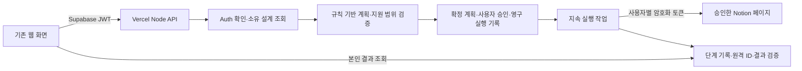

# [NB-V2-011A 작업 보고서]

조사 기준: 2026-10-30 / EST_Project `main` / `36db2f59f7da9d689cfa36a3d52432ddb362f793`.

## 1. 결론과 작업 범위

현재 서비스에 사용자별 Notion 연결과 웹 생성을 추가하는 것은 기술적으로 가능하다. 기존 화면·Auth·설계 저장·규칙 기반 계획 생성은 유지하고, **사용자별 OAuth 연결, 서버의 승인 검증, 영구 실행 기록, 중단 후 복구 가능한 실행 작업**을 추가하는 구조를 권장한다.

현재 CLI를 HTTP 요청에서 그대로 실행하는 방식은 적합하지 않다. CLI는 개발자 개인 테스트 공간, 파일 잠금, 특정 검증용 데이터에 묶여 있다. 특히 일반형은 실제 3DB 생성에 성공했지만, 임의의 사용자 설계를 빈 DB로 생성하는 범용 실행기는 아니다. 확장형은 계획 기능과 실제 생성 지원을 구분해야 한다.

이번 작업에서는 소스·설정·기존 문서를 수정하지 않았다. 이 보고서와 ChatGPT 인계 Markdown만 추가했다. 원격 조작은 Supabase 테이블 목록과 Vercel 프로젝트·배포 메타데이터 조회뿐이었다. SQL 실행, OAuth 시작, 토큰 발급·갱신·폐기, Notion 쓰기, Git commit·push, 배포는 수행하지 않았다.

## 2. 실제 확인한 현재 상태

| 구분 | 확인 결과 | 증거의 성격 |
| --- | --- | --- |
| Git | 시작 시 작업 트리 깨끗함. `main / 36db2f5` | 이번 로컬 조회 |
| 웹 구조 | 정적 HTML·JS·CSS, `public-dist` 빌드. 기존 서버 API 없음 | 최신 소스 |
| Vercel | `pplus`, Production READY, 배포 커밋이 로컬 HEAD와 같음. Node 설정 `24.x` | 이번 원격 메타데이터 조회 |
| 운영 주소 | `https://pplus-rouge.vercel.app` | 프로젝트 도메인 조회 |
| Supabase | 조회한 `public`·`private` 스키마의 테이블 목록에는 `public.education_drafts` 1개, RLS 활성, 행 수 메타데이터 5 | 이번 원격 목록 조회. 행 내용은 조회하지 않음 |
| 설계 저장 | version 1 설정에 requirements·mapping·planner 저장. 기본형·일반형·확장형, 선택 모듈·추천 조건 정규화 | 최신 소스 |
| 기본형 실제 생성 | 개인 테스트 부모 아래 빈 1DB 생성·재조회 기록 존재 | 과거 NB-V2-009A 증거. 이번 원격 재검증 아님 |
| 일반형 실제 생성 | 개인 테스트 공간 3DB·16속성·관계·Rollup·Formula·가상 7행 생성 기록 존재 | 과거 NB-V2-009B 증거. 이번 원격 재검증 아님 |
| 회사 복제 | 별도 테스트 B가 없어 실제 복제 확인 없음 | NB-V2-007B 기록 |

Vercel의 요금제, 실제 Fluid Compute 적용 여부, 실행 시간 설정, 서버 라우트 배포 가능성은 이 조회만으로 확정하지 않았다. Production 화면을 이번에 브라우저로 다시 검사하지도 않았다. Supabase Auth 설정·전체 카탈로그·모든 비공개 스키마를 감사한 결과로 해석하면 안 된다.

## 3. 재사용 가능한 코드와 제약

| 현재 파일 | 재사용할 부분 | 웹 연결 전에 필요한 보완 |
| --- | --- | --- |
| `js/drafts/model.mjs` | version 1 정규화, 저장 필드 제한, 512KiB 제한, planner 기본값 | 기존 JSON 형식 유지. 실행 기록·토큰을 configuration에 넣지 않음 |
| `js/drafts/repository.mjs` | 사용자별 저장·조회와 수정 충돌 처리 방식 | 서버에서는 검증된 사용자 JWT와 기존 RLS로 소유 설계 조회 |
| `js/planner/plan.mjs`, `catalog.mjs` | `planVersion 1`, DB·모듈·관계·계산 계획과 검증 | 서버에서 저장된 planner를 두 번째 인자로 명시적으로 전달 |
| `scripts/basic-notion/plan.mjs` | 정규 JSON, SHA-256, 기본형 속성 검증·요청 구성 원리 | 개인 workspace·테스트 부모 고정 제약을 대체하는 별도 서버 어댑터 |
| `scripts/basic-notion/engine.mjs` | 승인 해시, 단계 기록, 원격 재조회, 불확실한 POST 차단 원칙 | 파일 저장소를 영구 저장소와 분산 잠금으로 교체하는 새 실행 경로 |
| `scripts/standard-notion/*` | 관계 연결 순서, Rollup·Formula 변환, 원격 ID 재조회·검증 원리 | 3DB 범용화, 빈 행 생성, Status 지원 정책, 가상 데이터 의존 제거 |
| `scripts/notion-poc/client.mjs` | API 버전·오류 분류·읽기 호출의 기본 구조 | 사용자별 자격 증명 주입, 공유 요청 제한, 안전한 재시도 정보 보존 |
| `scripts/deployment/build-static.mjs`, `vercel.json` | 공개 파일 제한 | 서버 코드는 Functions 번들에만 포함하고 공개 출력에는 포함하지 않음 |

중요한 실제 제약:

- `createGenerationPlan(configuration, settings)`는 `configuration.planner`를 자동으로 사용하지 않는다. 서버는 정규화한 설정을 `createGenerationPlan(normalized, normalized.planner)`로 전달해야 한다.
- 기본형 실행기는 9개 기본 속성 유형을 지원하며 관계·Rollup·Formula·Status를 포함하는 계획을 그대로 실행하지 않는다.
- 일반형 실행기는 모듈 없는 일반형 3DB와 가상 사람 2·프로그램 2·신청 3행을 요구한다. 검증 코드에도 고정된 가상 식별자가 있다.
- 일반형 UI 계획에 포함되는 Status는 현재 실행기에서 거절된다. 과거 실험의 Select 변환을 모든 사용자에게 조용히 적용하면 안 된다.
- 확장형과 모듈 포함 계획은 현재 일반형 실행기의 지원 범위 밖이다. 실제 생성 버튼은 지원 범위를 통과한 경우에만 제공해야 한다.
- 기존 개인 CLI의 안전장치·승인 해시·manifest 형식은 보존한다. 웹 기능을 위해 개인 공간 제한만 제거하거나 개발자 토큰을 재사용하지 않는다.

현재 planner와 CLI의 Notion API 버전은 `2026-03-11`이다. 웹 실행 사양에도 버전을 고정하고, 향후 API 업그레이드를 기존 승인과 섞지 않아야 한다.

## 4. 이번에 수행한 기술 검증

기존 모듈을 Node 메모리에서 불러와 가상 설정으로 순수 함수만 실행했다. 파일 생성, 네트워크 호출, 실제 사용자 설계 변경은 없었다.

| 검사 | 실제 결과 | 의미 |
| --- | --- | --- |
| 기본형 계획 → 기본형 컴파일 | 유효, 속성 7개 | 검증한 기본형 입력은 재사용 가능 |
| 현재 일반형 계획 → 일반형 실행기 | `unsupported_property_type` | 계획의 Status와 실행기 지원 범위 불일치 |
| 확장형·출석·팀 계획 | 유효, 의존 모듈 포함 3모듈·6DB. 실행기는 `standard_template_only` | Dry Run 가능과 실제 생성 가능은 다름 |
| 일반형에 가상 행 없이 실행 준비 | `synthetic_seven_rows_required` | 현재 실행기는 빈 일반형 웹 생성에 바로 사용 불가 |
| 다른 워크스페이스 대상 | `personal_workspace_required` | 개인 테스트 제한이 실제 작동함 |
| 기존 009B 승인 요청 재계산 | 기존 요청 해시와 일치 | 이번 조사로 승인 요청을 변경하지 않음 |
| 저장 planner 전달 생략/전달 | 생략 시 basic, 전달 시 저장된 extended | 서버 구현 시 필요한 호출 조건 확인 |

전체 자동 테스트·V1 256조합·브라우저 검사는 이번에 재실행하지 않았다. NB-V2-010A 증거 파일의 Node 255개 통과와 V1 256조합, 실제 Supabase 저장 결과는 **이전 작업의 결과**다. 이번 순수 함수 검사는 OAuth 성공이나 사용자별 원격 생성 성공의 증거가 아니다.

## 5. 사용자별 Notion OAuth

### 공식 방식과 승인 범위

웹서비스는 Notion public connection의 OAuth를 사용한다. 승인 사용자마다 해당 워크스페이스에 묶인 토큰을 받는다. 같은 워크스페이스의 다른 사용자도 개별 승인이 필요하며, 개발자 개인 internal token을 전체 사용자의 권한으로 사용할 수 없다. 연결 등록 시 `Any workspace`와 `Selected workspaces only` 범위를 선택하며 등록 후 변경할 수 없다는 현재 문서의 제약을 고려해야 한다. 개발·운영 연결 분리를 권장한다. [Notion public connections](https://developers.notion.com/guides/get-started/public-connections)

일반 OAuth 승인 화면에서는 사용자가 전체 접근 권한을 가진 페이지를 선택한다. 허용한 부모의 하위 콘텐츠에도 접근이 이어질 수 있다. 이는 계정의 모든 페이지나 다른 워크스페이스 접근을 뜻하지 않는다. 이메일이 같다는 이유로 Supabase 사용자와 Notion 계정을 연결하지 않고, 서버가 확인한 Supabase 사용자와 OAuth 결과의 소유자·워크스페이스·bot 식별자를 묶는다. [Notion authorization](https://developers.notion.com/guides/get-started/authorization)

생성·구조 수정·재조회를 위해 read/insert/update content 권한을 검토한다. 사용자 이메일·댓글 등 불필요한 권한은 요청하지 않는다. 페이지를 읽을 수 있다는 것만으로 쓰기 가능성을 보장하지는 않는다. [Notion capabilities](https://developers.notion.com/reference/capabilities)

### 현재 SPA에 맞는 안전한 연결 순서 — 설계안

1. 브라우저가 Supabase Bearer JWT로 연결 시작 POST를 보낸다. 서버가 `getUser(jwt)`로 사용자를 확인한다. 요청 본문의 user_id나 브라우저의 사용자 표시를 신뢰하지 않는다. [Supabase getUser](https://supabase.com/docs/reference/javascript/auth-getuser)
2. 서버가 사용자 ID·단기 만료·난수 state 해시·브라우저 난수 해시를 연결 시도에 저장한다. 브라우저에는 OAuth 거래 확인용 HttpOnly·Secure·SameSite=Lax 쿠키를 설정한다. 기존 Supabase 로그인을 다시 구현하는 쿠키가 아니다.
3. Notion 승인 후 callback은 state·쿠키·만료를 확인하고 원자적으로 한 번만 소비한다. 고정된 운영 redirect URI를 사용하고 임의의 복귀 URL을 허용하지 않는다.
4. 서버가 client secret으로 코드를 교환한다. 토큰은 브라우저·URL·로그에 보내지 않고 암호화한 대기 연결로 보관한다. 토큰 교환 과정은 서버에서 수행한다. [공식 토큰 교환 흐름](https://developers.notion.com/guides/get-started/authorization)
5. callback에는 기존 SPA의 Supabase JWT가 자동 전달되지 않는다. 깨끗한 화면으로 돌아온 뒤 브라우저가 현재 JWT로 완료 POST를 보내고, 시작 사용자와 같은지 확인한 후 연결을 활성화한다. 진행 중 A에서 B로 계정이 바뀌면 B에 연결하지 않는다. 만료된 대기 연결은 폐기 대상으로 관리한다.

한 사용자가 여러 연결을 가질 수 있는 모델을 두되 초기 화면은 활성 연결 하나로 간소화할 수 있다. workspace_id를 전체 사용자에 대해 유일하게 설정하면 같은 회사의 서로 다른 사용자가 연결하지 못하므로 피한다.

### 갱신·철회·페이지 선택

토큰 갱신 시 새 access/refresh 쌍을 함께 보관하고, 동시 갱신은 연결별 잠금과 자격 증명 버전으로 직렬화한다. 고정 만료 시간을 가정하지 않는다. 재승인·권한 변경은 별도 grant revision을 올려 기존 대기 승인을 무효화한다. [Refresh a token](https://developers.notion.com/reference/refresh-a-token)

연결 해제 시 로컬 상태를 즉시 비활성화하고 새 작업·다음 단계를 막는다. 서버에서 토큰 철회를 시도하고 보관 자격 증명을 정리한다. 제공자의 철회 실패 시 안전한 재시도 상태와 Notion에서 직접 해제하는 안내가 필요하다. 철회 API 하나로 refresh token까지 어떤 범위로 무효화되는지는 실제 PoC에서 확인해야 한다. 진행 중 요청이나 이미 만든 DB는 자동으로 되돌리거나 삭제하지 않는다. [Revoke token](https://developers.notion.com/reference/revoke-token)

대상 페이지 목록은 본인 연결로 검색하고, 페이지 선택 후 서버가 같은 연결로 다시 조회한다. 검색은 완전한 접근 목록이 아니며 승인 직후 색인 지연도 있다. ‘목록 새로고침’과 페이지 링크 직접 입력을 제공하되, 서버는 Notion 페이지 ID만 추출하여 정해진 API로 조회한다. 입력 URL을 임의로 서버에서 가져오지 않는다. [Search](https://developers.notion.com/reference/post-search), [검색의 제약](https://developers.notion.com/reference/search-optimizations-and-limitations)

회사 관리자 정책은 사용자 승인보다 우선할 수 있다. 연결 설치나 페이지 접근이 제한되면 관리자 승인 안내가 필요하며, 개인 연결로 회사 정책을 우회하는 경로를 제공하지 않는다. 실제 회사 정책은 이번에 조회하지 않았다. [Notion 연결 관리](https://www.notion.com/help/add-and-manage-connections-with-the-api)

## 6. 서버 구성과 승인 검증 — 제안

정적 프런트엔드를 유지하고 Vercel Node Functions를 추가하는 방식이 현재 구조에 맞는다. 전체 Next.js 전환은 선행 조건이 아니다. 논리 API를 공유 라우터로 묶을 수 있으며 실제 파일 구성·정적 출력과 Functions의 동시 빌드는 후속 Preview에서 확인해야 한다. [Vercel Node runtime](https://vercel.com/docs/functions/runtimes/node-js)

| 제안 API | 역할과 제한 |
| --- | --- |
| POST `/api/notion/oauth/start` | 검증된 사용자로 단기 연결 시도 시작 |
| GET `/api/notion/oauth/callback` | 거래 확인·코드 교환. 콘텐츠 생성 금지 |
| POST `/api/notion/oauth/complete` | 현재 로그인 계정이 시작 계정인지 확인 후 활성화 |
| GET `/api/notion/connections` | 본인 연결의 안전한 메타데이터만 반환 |
| POST `/api/notion/connections/:id/disconnect` | 본인 연결 중지·철회 처리 |
| GET `/api/notion/pages` | 본인 연결로 허용 페이지 검색. 다른 사용자의 connectionId 거절 |
| POST `/api/notion/generation-reviews` | 소유 설계·최신 저장 시각·대상·지원 범위 확인 후 승인용 계획 작성 |
| POST `/api/notion/generations` | 유효한 일회 승인과 중복 키를 원자적으로 소비, 실행 등록, 202 반환 |
| GET `/api/notion/generations/:runId` | 본인 상태·안전한 오류·생성 링크 조회 |
| POST `/api/notion/generations/:runId/resume` | 확인된 미실행 단계만 재개. 변경된 범위에는 새 승인 필요 |

일반 사용자 요청은 해당 JWT로 `education_drafts`를 읽어 기존 RLS를 적용한다. 서버의 Secret/service_role은 RLS를 우회할 수 있으므로, 작업자가 이를 사용하더라도 모든 connection·draft·run의 소유권을 별도로 확인해야 한다. 공개 조회와 서버 쓰기의 GRANT·RLS를 각각 설계한다. [Supabase RLS](https://supabase.com/docs/guides/database/postgres/row-level-security)

승인에는 다음을 묶는다: 서버가 확인한 user ID, 설계 ID·updated_at·설정 해시, 연결 ID·grant revision·workspace·bot, 정확한 부모 페이지, API·컴파일러 버전, 실행 요청 SHA-256, 허용 쓰기 범위, 만료·일회 승인 식별자. 화면의 planId는 표시용이며 보안 승인 해시를 대신하지 않는다.

브라우저에서 임의의 Notion 요청·Formula·토큰·user_id를 받아 실행하지 않는다. 서버가 저장 설계를 정규화하고 planner를 전달해 다시 계산한다. 확인이 필요한 속성은 승인 전에 해결한다. 승인 직전 설계가 바뀌면 409로 재확인을 요구한다. 승인 후 설계 편집은 이미 확정된 실행 계획을 덮어쓰지 않는다. 실행기는 승인 당시 버전의 최소 실행 사양을 사용하며, 지원하지 않는 버전이면 재승인을 요구한다.

첫 실제 생성 범위의 제안은 **선택 부모 아래 새 결과 페이지 1개 + 빈 기본형 DB 1개, 교육생 행 0개**다. 부모에 기존 자료가 있어도 수정하지 않는 구조로 분리한다. 추가 페이지도 승인 요약·요청 수에 포함해야 한다. 이것은 제안이며 이번에 생성하지 않았다.

## 7. 생성 이력과 토큰 저장

`education_drafts`는 사용자 편집 설정에 계속 사용한다. 사용자에게 보이는 configuration에 토큰·승인 상태·실행 manifest를 넣으면 사용자가 바꾸거나 읽을 수 있으므로 실행의 근거로 사용할 수 없다. 완성된 웹 생성에는 별도의 영구 기록이 필요하다. **이번에 테이블을 생성하거나 SQL을 작성·실행하지 않았다.**

| 논리 저장 대상 | 제안 내용 | 접근 방식 |
| --- | --- | --- |
| `notion_connections` | 소유자, Notion 사용자·workspace·bot, 이름, 상태, grant revision, 확인 시각, 비밀 저장 참조 | 소유자만 안전한 메타데이터 조회. 브라우저 직접 추가·변경 금지 |
| `notion_generation_runs` | 소유자, 원본 설계 참조·버전, 실행 ID·상태, 확정 실행 사양·해시, 대상, 승인, 중복 키, 단계 기록, DB/DS/속성 ID, 링크, 오류·재개 정보, 잠금 버전 | 소유자 조회 RLS. 생성·상태 전이는 서버 전용 |
| 비공개 자격 증명 저장소 | access/refresh 쌍, 암호화·키 버전, 회전 버전 | API에 노출하지 않는 private 저장소 또는 관리형 비밀 저장소 |
| 단기 OAuth 거래 저장소 | 사용자, state/브라우저 난수 해시, 만료·소비 상태, 대기 연결 참조 | 서버만 접근하는 원자적 단기 저장소 |

모두 Supabase에 직접 구현한다면 예를 들어 공개 메타데이터·실행 2개와 private 자격 증명·OAuth 거래 2개로 총 4개 테이블이 될 수 있다. Vault·외부 단기 저장소 선택에 따라 실제 물리 테이블 수는 달라진다. 먼저 저장할 책임과 접근 권한을 확정하고, 후속 승인으로 확정할 사항이다. 기존 테이블을 중복 생성하거나 `education_drafts` 구조·version 1·RLS를 바꿀 이유는 없다.

토큰은 서버 전용 암호화 저장소에 보관하고 키는 DB와 분리한다. Vault를 사용해도 복호화 뷰·함수의 권한이 핵심이다. 공개 테이블의 암호화 문자열만으로 안전하다고 간주하지 않는다. 서버 역할의 최소 권한, private 스키마 비노출, 복호화 함수의 공개 실행 차단, 로그 마스킹, 재승인·폐기·키 회전 정책을 함께 검증한다. [Supabase Vault](https://supabase.com/docs/guides/database/vault)

실행 기록은 로컬 manifest의 역할을 이어받는다. 전체 거대한 Dry Run을 중복 저장하기보다 승인된 최소 실행 사양과 단계별 요청 해시·원격 ID를 보관한다. 초기에는 단계 기록을 run의 JSONB와 버전 비교 갱신으로 관리하고, 규모가 커지면 단계 테이블 분리를 검토한다. 성공·부분 실패 기록의 보관 기간과 계정 삭제 정책은 구현 전에 확정해야 한다.

## 8. 중복 생성·실패·요청 제한

- 실행 등록은 소유자별 idempotency key와 payload hash로 중복을 막는다. 같은 키·다른 요청은 409다. 같은 계획의 의도적인 복사본은 별도 승인과 새 키를 사용한다.
- DB 트랜잭션·고유 제약·lease/fencing 버전으로 실행과 부모 대상의 동시 쓰기를 제어한다. 기존 파일 잠금은 여러 서버 인스턴스를 막지 못한다. Vercel의 파일 시스템과 임시 공간은 영구 manifest 저장소를 대신하지 않는다. [Vercel runtimes](https://vercel.com/docs/functions/runtimes)
- 단계별로 전송 전 상태를 영구 기록하고, 반환된 원격 ID를 저장한 뒤 다음 단계로 이동한다. POST 응답을 잃거나 Notion 성공 뒤 기록 저장이 실패하면 `uncertain/manual_review`로 둔다. 잠금 만료나 작업 재전달만으로 실패했다고 판단해 재생성하지 않는다.
- 알려진 ID는 재조회로 판정한다. ID를 모르는 불확실한 생성은 후보 조회와 사용자 검토로 넘기고, 자동 재POST·후보 자동 채택·자동 삭제를 하지 않는다. 부분 생성물과 링크를 보존한다.
- API 호출 성공만으로 완료하지 않고 DB·Data Source·속성·관계를 재조회하여 승인 사양과 비교한다. 재개는 확인된 미실행 단계부터 가능하다.

현재 Notion 문서는 연결별 분당 요청 한도를 Business/Enterprise 600회, 그 외 180회로 구분하며 워크스페이스 공유 한도도 명시한다. 여러 서버의 개별 350ms 대기만으로는 충분하지 않다. 연결·워크스페이스 기준의 공유 제한과 `Retry-After` 처리가 필요하다. 503 쓰기는 이미 적용됐을 가능성이 있으므로 응답의 retry guidance와 원격 ID를 확인해야 한다. 기존 client의 일반 자동 재시도를 생성에 그대로 사용하지 않고 현재 CLI처럼 쓰기 자동 재시도는 비활성화한다. 읽기는 제한된 backoff와 jitter로 재시도하고 쓰기는 오류 유형별 안전성을 판단한다. [Notion request limits](https://developers.notion.com/reference/request-limits)

Free의 블록 한도·권한 거절은 429와 구분해야 한다. 현재 문서는 Free의 다중 멤버 여부·연결 유형 등에 따라 적용 조건을 구분한다. ‘모든 Free가 불가능하다’거나 public 연결이 회사 정책·모든 한도를 우회한다고 설명하면 안 된다. [Workspace block limits](https://developers.notion.com/reference/workspace-block-limits)

서버 API는 작업 등록 후 202를 반환하고 브라우저가 상태를 조회하게 한다. 긴 생성은 내구성 있는 실행 작업을 권장한다. Vercel Workflow는 중단·재개 구조의 후보지만, 실제 프로젝트의 비용·적용 조건·실행기 연동은 미검증이다. Queue를 선택하면 최소 한 번 전달을 전제로 같은 단계가 다시 도착해도 안전해야 한다. 자동 재시도만으로 Notion 생성의 exactly-once가 보장되지 않는다. [Vercel Workflows](https://vercel.com/docs/workflows), [Vercel Queues](https://vercel.com/docs/queues)

실행 시간은 실제 요금제·설정에 따라 달라지므로 고정 제한을 가정하지 않는다. 한 HTTP 요청 안의 장시간 실행이나 브라우저 연결 유지에 의존하지 않는다. [Vercel Function duration](https://vercel.com/docs/functions/configuring-functions/duration)

등록과 작업 전달 사이의 실패도 처리해야 한다. 예를 들어 run에 `dispatch_pending`을 기록한 뒤 전달하고, 재조정 작업이 미전달 run만 재전달하게 한다. 작업에는 Supabase 세션 JWT를 장기 보관하지 않고 승인된 run ID와 서버의 제한된 권한을 사용한다. 로그아웃은 새 요청을 차단하되 이미 승인한 작업이 계속될지는 화면에 명시할 제품 정책이다. 연결 해제·취소는 이후 단계 시작을 중지하며 이미 전송한 외부 쓰기의 취소는 보장하지 않는다.

## 9. UI·UX 제안과 사용자 작업량

첫 이용 흐름: 로그인 → 저장 설계 열기 → **Notion 연결** → 공식 승인 → 부모 페이지 선택 → 짧은 생성 요약 → **빈 DB 생성 승인** → 진행 상태·결과 링크.

다음 이용에서는 유효한 본인 연결과 최근 부모를 제안해 OAuth 반복을 줄인다. 대상 접근 재확인과 명시적 생성 승인은 유지한다. 화면에서 수정한 내용이 저장본과 다르면 먼저 저장하게 하여 승인 대상이 분명하도록 한다.

| 경우 | 보여줄 내용 | 생성 허용 기준 |
| --- | --- | --- |
| 기본형 | 부모·새 페이지·DB 1개·주요 속성·행 0개·예상 작업 범위 | 지원 속성·미해결 항목 검증 통과 |
| 일반형 | 사람 → 신청기록 ← 프로그램의 연결 그림, DB별 역할·집계 설명 | 가상 행 없는 범용 실행·Status 정책 검증 후 |
| 확장형 | 선택 모듈별 추가 DB·관계·계산, 미지원 항목 | 현재는 미리보기만. 지원 검증 전 실제 생성 차단 |
| 실패 | 재연결·관리자 문의·재검토·부분 결과 링크 등 상황별 안내 | 불확실한 실패에 ‘다시 생성’ 유도 금지 |

사용자의 첫 연결·대상 선택·계획 확인·승인이라는 판단 단계를 최소한으로 유지한다. 실제 클릭 수와 소요 시간은 사용자 테스트를 하지 않았으므로 수치로 확정하지 않는다. 009B 가상 7행을 실제 서비스 생성에 자동 삽입하지 않는다.

## 10. 회사 워크스페이스 경로 비교

| 경로 | 장점 | 제약·확인할 점 | 현재 검증 상태 |
| --- | --- | --- | --- |
| 개인 Notion 생성 → 회사에 수동 복제 | 회사 API 연결이 허용되지 않을 때 검토 가능 | 대상 권한·회사 반출입 정책·복제 허용 필요. 관계·Rollup·Formula·연결 대상·권한을 복제 후 재검사 | 회사 복제 미실시. 성공 보장 불가 |
| 사용자가 회사 연결 승인 → 회사 페이지 직접 생성 | 다른 공간으로 옮기는 과정과 관계 재매핑을 줄일 수 있음 | 관리자 허용·본인 페이지 권한·회사 승인 절차 필요. 회사 계정이라는 이유만으로 허용되지 않음 | 사용자별 OAuth·회사 생성 미실시 |
| 템플릿·CSV로 수동 구성 | API 연결 없이 적용할 대안이 될 수 있음 | 가져오기·템플릿 정책 필요. CSV만으로 관계·계산·색상을 완전 복원하지 못함. 자동 내보내기·배포 기능은 현재 미구현 | 대안 설계만 수행 |

Notion은 공간 간 콘텐츠 이동·복사 경로를 안내하지만 연결·권한 등의 손실 가능성을 경고한다. 특히 개별 DB 복제와 전체 묶음 복제를 같다고 가정하지 말고, 별도 B에서 외부 참조까지 확인해야 한다. CSV의 관계는 URL 텍스트로 나가며 다시 가져와도 관계로 자동 복원되지 않는다. [공간 간 이동](https://www.notion.com/help/transfer-content-to-another-account), [관계·Rollup 제한](https://www.notion.com/help/relations-and-rollups)

개인 생성은 회사의 정보 취급 정책을 충족한다는 증거가 아니다. 회사 자료를 개인 공간으로 옮기는 실험은 포함하지 않는다. OAuth 승인 중 템플릿 복제 옵션도 임의의 기존 3DB 묶음을 회사로 안전하게 옮기는 기능과 같지 않다.

## 11. 구현 우선순위와 다음 작은 범위

| 단계 | 구현 범위 | 진행 전에 필요한 확인 |
| --- | --- | --- |
| 1. 권장 NB-V2-011B | **인증된 서버 Dry Run·실행 가능 범위 검사만**. 저장 설계 소유권 확인, planner 전달, 계획·해시·미지원 이유 반환 | 새 테이블·SQL·OAuth·Notion 네트워크·생성 버튼 없이 가능. 코드 구현·검증 후 배포는 별도 범위 |
| 2. OAuth 읽기 전용 PoC | 본인 계정 연결·페이지 목록·해제. 토큰 회전·계정 변경 방어 | public 연결 등록, 정확한 redirect, 서버 비밀 보관·단기 거래 저장 설계와 원격 변경 승인 |
| 3. 기본형 웹 생성 | 영구 run·중복 방지·내구 실행·빈 기본형 1DB·원격 재조회 | DB/RLS 검토·승인, 실제 생성 범위 별도 승인, 장애·동시 요청 검증 |
| 4. 일반형 범용화 | 가상 7행 의존 제거, 빈 3DB, 관계·계산·Status 지원 정책 | 기존 CLI 보존, 새 어댑터와 실제 테스트 공간 검증 |
| 5. 확장형·회사 경로 | 모듈별 실제 생성, B 복제 또는 허용된 회사 직접 생성 | 모듈별 검증과 분리된 테스트 B·관리 정책·구체 승인 |

1단계 완료 기준: 비로그인 401, 타인 설계 거절, 클라이언트 변조 설정 무시, 저장 planner 정확한 반영, 동일 사양의 SHA-256 일관성, 저장본 변경 감지, 지원하지 않는 일반형·확장형을 실행 가능으로 표시하지 않음, Notion 호출 0회. 기존 Auth·version 1·planVersion 1·CLI·공개 빌드 제한을 보존한다.

## 12. 검증 상태와 종료 상태

**이번에 확인:** 최신 소스와 깨끗한 시작 Git, Vercel Production 커밋 메타데이터, Supabase 테이블 목록·RLS 플래그, 순수 함수의 실제 제약, 공식 OAuth·권한·실행 인프라 문서.

**과거 증거를 참고:** 기본형·일반형 개인 Notion 실제 생성, 010A 저장·복원 및 자동 검사. 현재 웹 사용자 OAuth 생성 성공으로 확대 해석하지 않는다.

**설계 제안:** API·저장 대상·암호화·거래 확인·승인 해시·분산 실행·UI 흐름. 아직 구현하지 않았다.

**미검증:** 실제 OAuth 설치·refresh·revoke 범위, 사용자별 연결 격리, 회사 관리자 정책·복제, 서버 route 빌드·실행 한도·Workflow 적용 비용, 동시 실행 장애 복구, 빈 일반형·확장형 실제 생성, 새 웹 흐름의 브라우저·모바일 경험.

종료 시 Git HEAD·브랜치는 시작과 동일하다. 이번 추가 파일은 `docs/research/NB-V2-011A_REPORT.md`, `docs/chat-handoff/NB-V2-011A_CHATGPT_HANDOFF.md` 두 개뿐이다. 코드·기존 사용자 설계·원격 설정·Notion 자료·배포를 변경하지 않았다.
